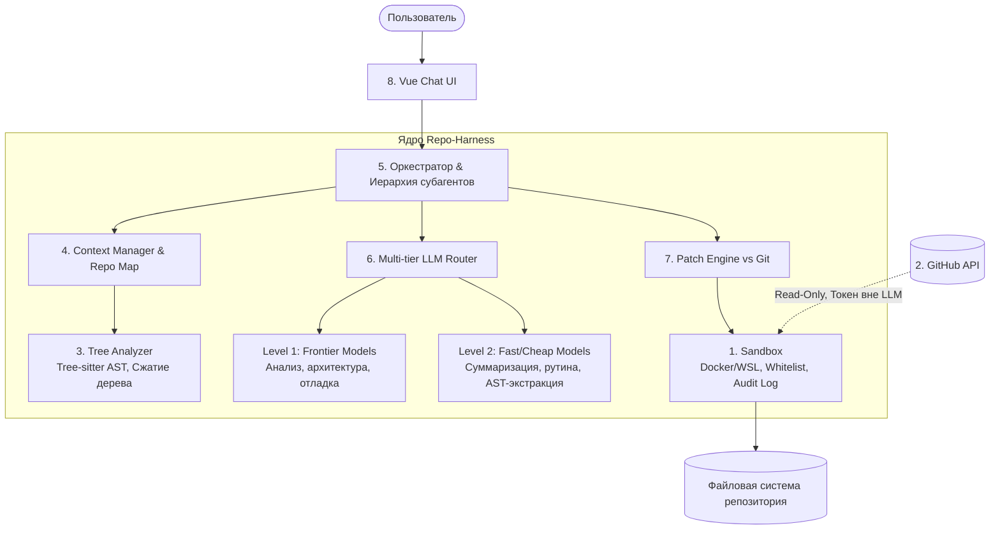

# Repo-Harness: База знаний и инженерный регламент проекта

## 1. Концепция и цель проекта
Проект посвящён созданию **Repo-Harness** — локальной, LLM-агностичной среды исполнения (обвязки) для работы с большими кодовыми базами на уровне целых репозиториев, а не отдельных изолированных файлов.

### Ключевые возможности целевой системы:
1. **Перенос кодовых баз (Migration/Porting)**: Автоматизированный перевод крупных репозиториев с исходных языков (JS/TS, Go, Rust, C++) на единый целевой язык (**Python**).
2. **Синтез и слияние репозиториев (Repository Synthesis)**: Объединение функциональности двух и более независимых репозиториев в единый продукт на одном языке (референсный сценарий: слияние `n8n` — оркестрация workflow, и `ComfyUI` — графовый запуск моделей).
3. **Воспроизводимость и управляемость**: Детерминированные метрики качества, строгий контроль расхода токенов и стоимости, воспроизводимые эксперименты.

---

## 2. Архитектура системы (8 ключевых модулей)

### Спецификация модулей:
1. **Sandbox (Песочница)**:
   - Локальная изоляция (Linux / WSL / Docker).
   - Строгий whitelist разрешённых команд и аргументов.
   - Защита от path traversal, symlink-атак, побегов из рабочей директории.
   - Ограничения CPU, памяти, таймаутов процессов и доступа в сеть.
   - Audit Log всех действий агентов с визуализацией в UI.
2. **Безопасная интеграция с GitHub**:
   - Чтение приватных/публичных репозиториев пользователя через персональный токен.
   - Токены хранятся строго вне контекста LLM и вне песочницы.
   - Только права Read-Only; операция `git push` технически заблокирована.
3. **Анализ структуры проекта (Tree Analyzer)**:
   - Генерация компактного дерева файлов репозитория.
   - Автоматическое сворачивание служебных папок (`node_modules`, `.git`, `.venv`, `dist`, датасеты).
   - Структурный AST-анализ кода на базе Tree-sitter: извлечение символов, классов, функций, графа зависимостей и точек входа.
4. **Управление контекстом (Context Manager)**:
   - Динамическая загрузка и выгрузка (eviction) файлов (включая код, PDF, изображения, аудио).
   - Формирование сжатых сводок (Repo Map, Module Summaries) вместо помещения сырых файлов в контекст.
   - Сжатие истории диалога и результатов выполнения тулов.
   - Персональный контекстный скоупинг для каждого субагента.
5. **Оркестратор и субагенты**:
   - Иерархическая декомпозиция задач.
   - Изолированные контексты субагентов.
   - Механизм обмена результатами и бесконфликтного слияния правок.
   - Автоматический цикл валидации (запуск тестов, линтеров, статического анализа).
   - Защита от бесконечных циклов и лимиты расходов.
6. **Многоуровневые модели (Multi-tier Routing)**:
   - LLM-агностичность через абстрактный провайдер / LiteLLM Proxy.
   - **Level 1 (Frontier)**: Сложное планирование, архитектура, сложный дебаг (GPT-4o, Claude 3.5 Sonnet, Gemini 1.5/2.0 Pro).
   - **Level 2 (Fast/Utility)**: Рутинные правки, суммаризация файлов, первичная фильтрация (Gemini Flash, Haiku, GPT-4o-mini, локальные Qwen/DeepSeek).
   - Внешний аудит расхода токенов и стоимости.
7. **Применение изменений: Patch Engine против Git**:
   - Подход А: Собственный движок патчей на блоках `search/replace`.
   - Подход Б: Использование Git (ветки, микро-коммиты, `git diff`, `git apply`, `git revert`, `git reset`).
   - Эмпирическое сравнение обоих подходов на бенчмарках.
8. **Чат-интерфейс на Vue**:
   - Локальный веб-интерфейс, поддержка drag-and-drop файлов и `.zip` архивов.
   - Изолированный каталог пользовательских загрузок внутри песочницы.
   - Интерактивная визуализация шагов агентов и дерева проекта.

---

## 3. Метрики успеха и протокол валидации (KPI K1–K9)

Все результаты подтверждаются внешними детерминированными замерами (без ручного вмешательства человека, минимум 3 повтора на задачу с расчётом 95% доверительного интервала bootstrap).

| Метрика | Название | Описание и формула |
| :--- | :--- | :--- |
| **K1** | **Успешный запуск** | Доля запусков, где результат устанавливается в чистом контейнере 1 командой и проходит health check за заданное время. |
| **K2** | **Функциональная полнота** | Доля пройденных тестов приёмки (портированные тесты оригинала + дифференциальные тесты сопоставления входов/выходов). |
| **K3** | **Успешная задача** | Бинарный критерий: $K1 = 1$ И $K2 \ge 90\%$. |
| **K4** | **Стоимость** | Средняя стоимость запуска ($) и удельная стоимость на одну успешную задачу: $\frac{\sum \text{Cost}}{\text{Count}(K3=1)}$. |
| **K5** | **Токены** | Входные, выходные и кэшированные токены на запуск и в пересчёте на 1000 строк исходного кода (kLOC). |
| **K6** | **Время и шаги** | Полное время выполнения (wall-clock time) и количество шагов оркестратора/субагентов. |
| **K7** | **Автономность** | Число зависаний, зацикливаний и аварийных остановок; доля запусков без ручного вмешательства человека. |
| **K8** | **Надёжность правок** | Доля успешно применившихся патчей, доля успешных откатов, доля правок-регрессий (сломавших ранее зелёные тесты). |
| **K9** | **Стабильность** | Стандартное отклонение и 95% доверительный интервал для K3 и K4 между повторными запусками. |

---

## 4. Конфигурации для сравнительного анализа

1. **Repo-Harness (Full)**: Наша система в полной комплектации.
2. **Открытые харнесы-конкуренты (2-3 шт.)**: SWE-agent, OpenHands, Aider, MetaGPT (запуск автономно на той же модели через API).
3. **Наивные Baseline**:
   - Single-Prompt (вся кодовая база за один вызов модели с большим контекстным окном).
   - Частичная передача без иерархической оркестрации.
4. **Абляционные исследования (Ablation Studies)**:
   - Без выгрузки контекста (no-eviction).
   - Без субагентов (монолитный агент).
   - Без маршрутизации моделей (только L1).
   - Без суммаризации (сырые файлы).
   - Patch Engine против Git.

---

## 5. Набор задач бенчмарка (Benchmark Suite)

1. **Тип А: Перенос на Python (минимум 6 задач)**:
   - **S (< 5 kLOC)**: Библиотеки парсинга (например, `marked`, `markdown-it` с JS на Python) с эталонным сьютом тестов.
   - **M (5–50 kLOC)**: CLI-утилиты, сетевые библиотеки с развитыми интеграционными тестами.
   - **L (> 50 kLOC)**: Сложные многомодульные подсистемы.
2. **Тип Б: Слияние репозиториев (минимум 3 пары)**:
   - Сквозная спецификация $N$ целевых функций объединённого продукта с автотестами (E2E API, CLI, браузерные сценарии).
   - Демонстрационная пара: `n8n` + `ComfyUI`.

---

## 6. Регламент подготовки еженедельных отчётов (ИТМО)

1. **Формат сдачи**: Одностраничный интерактивный HTML-отчёт (`index.html`) + assets (схемы, графики, таблицы, скриншоты подтверждений).
2. **Сводная таблица**: Обязательно в начале каждого отчёта (Блоки 1–7 со статусами: сделано / частично / не вышло).
3. **Строгая достоверность**: Никаких выдуманных данных. Ошибки и неудачи фиксируются с анализом причин — это ценный исследовательский результат.
4. **Обязательное подтверждение окружения**: Скриншоты и логи успешных вызовов API моделей (Google AI Studio) и локальных сред.

---

## 7. Дополнительные ссылки и материалы
- [Детальное описание KPI и формул](./references/kpi_metrics.md)
- [Спецификация модулей архитектуры](./references/architecture_specs.md)
- [Методология бенчмарка](./references/benchmarks.md)
- [Памятка по еженедельному отчёту](./references/reporting_guide.md)
